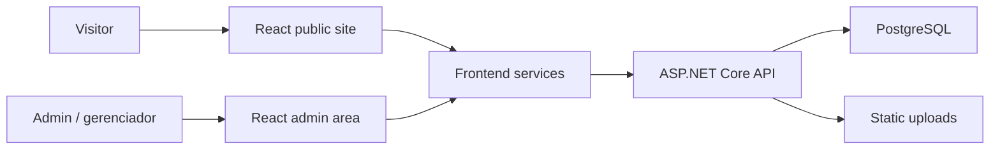

# Architecture

The repository is organized as a small monorepo with two main applications:

- `vitrine/` - React frontend built with Vite.
- `backend/VitrineAPI/` - ASP.NET Core API backed by PostgreSQL.

## Logical flow

## Frontend

The frontend is a single React application. Public and admin screens share the same routing tree, components, hooks and service layer.

Important folders:

- `src/pages/` - route-level pages.
- `src/components/` - reusable UI, layout and feature components.
- `src/services/` - Axios calls to backend endpoints.
- `src/hooks/` - query and feature hooks.
- `src/schemas/` - Zod schemas for forms and validation.
- `src/store/` - client-side state, including auth-related state.
- `src/routes/` - route definitions and protected areas.

## Backend

The backend follows a feature-folder structure under `Features/`. Each domain groups endpoints, request/response contracts and validators.

Important folders:

- `Database/` - Entity Framework context and models.
- `Features/Projects/` - project endpoints and contracts.
- `Features/WorksDone/` - work-done endpoints and contracts.
- `Features/Teachers/` - teacher endpoints and contracts.
- `Features/Upload/` - image upload endpoint.
- `Migrations/` - database migrations.

## Data flow

1. A page renders and calls a hook or service.
2. The frontend service uses the shared Axios instance from `src/services/api.ts`.
3. The API handles the request through a controller endpoint.
4. Entity Framework reads or writes PostgreSQL data.
5. Responses return JSON to the frontend.

## Deployment shape

The Docker setup builds:

- the frontend into static files served by Nginx;
- the backend as a .NET container exposed on port `8080` internally.

The root `docker-compose.yml` maps:

- frontend container to `http://localhost:3000`;
- backend container to `http://localhost:5000`.
